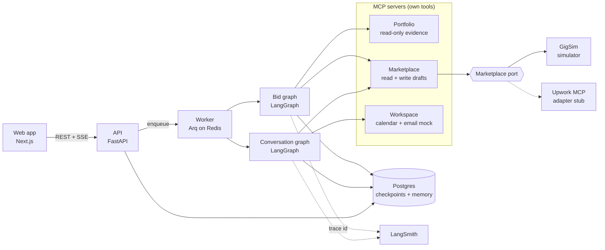
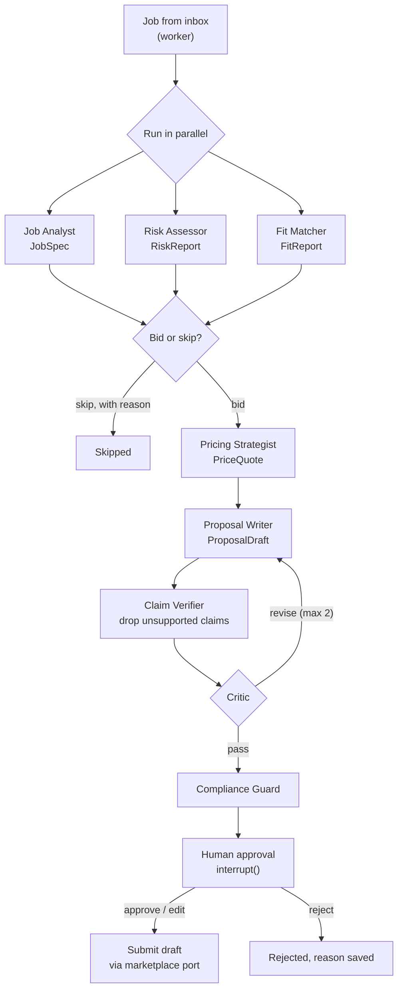
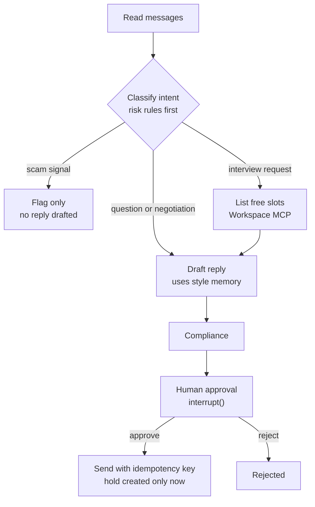

# GigBid: a multi-agent freelancer copilot

[](https://github.com/rauf17/gigbid/actions/workflows/ci.yml)

GigBid finds freelance jobs, decides which are worth bidding on, and drafts proposals that cite only
verified portfolio evidence. A team of LangGraph agents does the analysis, and a human approves
every proposal and message before it leaves the system.

AI-4016 R&D Assignment II, by Abdul Rauf (23I-0591). All data is synthetic and the marketplace is the
GigSim simulator.

| | |
|---|---|
| **Demo video** | [Watch the walkthrough](<VIDEO_URL>) |
| **Hosted frontend (demo mode)** | [Open the Vercel demo](https://gigbit-connect.vercel.app) |
| **Write-up** | [My Retrieval Evaluation Lied to Me Three Times](https://dev.to/rauf17/my-retrieval-evaluation-lied-to-me-three-times-2l8n) |
| **R&D report** | [docs/REPORT.pdf](docs/REPORT.pdf) |
| **Portfolio MCP server** | [install with `uvx`](#portfolio-mcp-server) |
| **Public traces** | [three LangSmith traces](#public-traces) |

> **Deployment status, stated plainly.** The Vercel site is the Next.js frontend in **demo mode**
> (`NEXT_PUBLIC_MOCK=1`). It shows fixture data under a `DEMO DATA` banner and does **not** run the
> agents. The full system (API, worker, Postgres, Redis, MCP servers, GigSim and the LangGraph agents)
> runs with `docker compose up` and in the single-container `gigbid-space` image. A public hosted
> backend is **pending**: the Azure account is still under review and no other free host could be
> arranged. It will be deployed once that is confirmed with the course staff. The demo video was
> recorded against the full stack on localhost. The reviewer login is in the private Classroom
> comment, not in this repo.

---

## What it does

1. **Triages jobs.** Each job is analysed in parallel for requirements, risk and fit with the portfolio.
2. **Decides** to bid or skip with a deterministic rule, then prices the bid.
3. **Writes a grounded proposal.** Every claim cites portfolio evidence (`[E:id]`). A claim verifier
   removes unsupported claims, a Critic reviews the draft (at most two revisions), and a Compliance
   Guard sanitises the final text.
4. **Stops for a human.** The reviewer sees the draft, the evidence behind each claim, the risk
   report, the price rationale and a dry-run preview. They approve, edit or reject. Nothing is sent
   before this point.
5. **Handles client replies** in a second graph with the same approval gate.
6. **Learns** a style memory from the reviewer's edits and an outcome memory of what won, only through
   explicit promotion rules.

---

## Architecture

The diagrams below are Mermaid, so GitHub renders them live. Click a diagram to pan and zoom. Static
PNGs of both graphs are in [docs/images/](docs/images/).

### System overview



### Bid graph



### Conversation graph



### Three kinds of state

| Kind | Where it lives | What it holds |
|---|---|---|
| **Graph state** | In memory, per run | Typed hand-offs between nodes (`JobSpec`, `RiskReport`, `FitReport`, `BidDecision`, `PriceQuote`, `ProposalDraft`) |
| **Long-term memory** | `AsyncPostgresStore` | Style rules promoted after repeated edits, win rates per job category |
| **Application database** | PostgreSQL | Users, run history, audit trace, LangGraph checkpoints |

More detail: [docs/ARCHITECTURE.md](docs/ARCHITECTURE.md), [docs/TOOLS.md](docs/TOOLS.md) (every MCP tool),
[docs/adr/](docs/adr/) (decisions).

---

## Results

Every number here is copied from a file in `evals/results/`, and
[docs/results_index.md](docs/results_index.md) maps each one to its source file. The dev set is 600
synthetic jobs across three personas (511 have gold evidence).

### R&D question B: retrieval

| Variant | Recall@5 | Ceiling | MRR | nDCG@10 | p95 (ms) | Tokens |
|:---|:---:|:---:|:---:|:---:|:---:|:---:|
| `random` | 0.1349 | 0.6806 | 0.3850 | 0.2454 | 0.0 | 0 |
| `bm25_text` | 0.2760 | 0.6806 | 0.6229 | 0.4720 | 20.4 | 0 |
| `skill_tag_lookup_REFERENCE`* | 0.4017 | 0.6806 | 0.5680 | 0.5404 | 2.1 | 0 |
| **`v0_naive` (active in config)** | **0.2867** | 0.6806 | 0.7417 | 0.4617 | 88.9 | 0 |
| `v1_decompose` | 0.2276 | 0.6806 | 0.6660 | 0.4014 | 1671.9 | 363,928 |
| `v2_hybrid` | 0.3121 | 0.6806 | 0.7363 | 0.4870 | 296.7 | 0 |
| `v3_rerank` | 0.3308 | 0.6806 | 0.7397 | 0.4878 | 2982.4 | 0 |
| `v4_outcome` | 0.3298 | 0.6806 | 0.7396 | 0.4880 | 133.2 | 0 |
| `oracle` | 0.5564 | 0.6806 | 1.0000 | 0.8520 | 0.0 | 0 |
| `v0_naive_unfiltered` | 0.0519 | 0.6806 | 0.1904 | 0.0845 | 0.0 | 0 |

\* Reference only. It queries the skills field the gold labels were derived from.

- **Active configuration:** `agent/config.yaml` selects `v0_naive` (dense embedding retrieval with persona filtering); `v2_hybrid` (BM25 + dense, reciprocal rank fusion) was evaluated as the primary ablation candidate. The
  reranker gained negligible nDCG@10 over V2 for roughly ten times the latency.
- **Negative results:** hybrid gained +2.54 points of Recall@5 against a pre-registered +8.
  Decomposition hurt (-5.91 points). Outcome-aware boosting was neutral.
- **Past proposals in the pool** dropped Recall@5 from 0.2867 to 0.0519, so retrieval is restricted to
  evidence types by default.

### R&D questions A and C

| Question | Status |
|---|---|
| A: tool granularity (40 tasks) | **not run**. The design is in the report. |
| C: single agent vs supervisor vs graph | **not run**. No baseline results exist. |

### Pipeline and defences

| Benchmark | Primary metric | Value | p95 (ms) |
|:---|:---|:---:|:---:|
| Decision pipeline | Bid/skip F1 | 0.7500 | 921.85 |
| Proposal verification | Unsupported claims after verification | 0.0000 | 1411.7 |
| Injection defence | Defence effectiveness | 0.7778 | 2722.5 |
| Scam detection | Precision / Recall ($n=78$, 18 scam) | 1.0000 / 0.2778 | 921.85 |

The injection and proposal evaluations used 10 and 15 samples, so treat them as indicative. Scam detection was evaluated on 18 scam jobs out of 78 total opportunities.

### Extension X2: proposal A/B test

Two opener strategies on the same 120 jobs: result-first (arm A) and question-first (arm B). Source:
`ab_experiment_latest.json`.

| | Reply rate | Hire rate |
|---|:---:|:---:|
| Arm A | 0.2333 (28/120) | 0.0417 (5/120) |
| Arm B | 0.1083 (13/120) | 0.0000 (0/120) |

The reply difference is significant (exact McNemar p = 0.0015). The hire difference is **not**
(Fisher's exact p = 0.0599). GigSim's clients reward numeric specificity by construction, so this
tests the pipeline and the simulator's rule, not real-world effect.

### Latency and cost budgets

Measured on 20 jobs, with the fallback model and cache in play, so this is **not a clean run**.
Source: `budget_latest.json`.

| Stage | Declared target | Measured p95 | Mean tokens | Mean cost |
|:---|:---:|:---:|:---:|:---:|
| Job analysed | 12.0 s | 9.749 s | 1024.7 | $0.000000 |
| Proposal | 25.0 s | 8.780 s | 2256.5 | $0.000000 |

In `data/processed/llm_calls.jsonl`, 28 of 87 calls (32.2%) used the fallback model after the primary
Groq limit was hit, and 26 of 87 were served from cache. The critic-prompt trimming is an estimated
saving, not measured end to end. The hidden test set was not available, so these are dev-set numbers.

### Change request (our own drill)

No instructor change request was released in Classroom before submission, so we ran our own. A new banned phrase, a
shorter length cap and a higher fit threshold changed only `agent/config.yaml` and
`data/policy_pack/policy.yaml`, with no Python edits. See [docs/CHANGE_REQUEST.md](docs/CHANGE_REQUEST.md).

---

## Public traces

LangSmith traces with personal data masked.

- **Approved proposal.** [Trace `faeba433`](https://smith.langchain.com/public/2aae5f31-ef89-4227-b200-acc3312bfee0/r/faeba433-c7f4-4d05-8b68-5d45da01683f?start_time=2026-11-15T14%3A54%3A04.542224Z): the run pauses at the approval checkpoint and resumes to submission.
- **Critic revision loop.** [Trace `bd69772d`](https://smith.langchain.com/public/c1f62c90-1db6-4b63-9bc1-a6a708ae541e/r/bd69772d-b602-47d7-b272-712775da298c?start_time=2026-11-15T14%3A54%3A42.910478Z): the Critic sends the draft back for revision.
- **Crash and resume.** [Trace `8b55430b`](https://smith.langchain.com/public/9abace65-e566-4584-8445-c982b45823ed/r/8b55430b-ea67-4d21-841c-d1bf9cd5c9bb?start_time=2026-11-15T14%3A54%3A52.485806Z): state is recovered from the Postgres checkpoint after a simulated crash at approval.
- **Skipped scam.** Run `9cb84a55-d506-41ac-b460-bd6ba763d9dd` exists in the LangSmith project. A public share link could not be generated before submission.

---

## Run it

Tested single-container execution:

```bash
cp .env.example .env
docker build -f infra/docker/space.Dockerfile -t gigbid-space .
docker run --rm -p 7860:7860 --env-file .env gigbid-space
```

Then open `http://localhost:7860` and sign in with reviewer credentials.

> [!NOTE]
> `docker compose up`: not re-tested; the verified single-container run is `gigbid-space` on port 7860. Operations, schedules and recovery steps are in [docs/RUNBOOK.md](docs/RUNBOOK.md).

| Command | What it does |
|---|---|
| `make test` | Unit, contract and integration tests |
| `make lint` | Ruff and the repo rule checks |
| `make eval` | Retrieval, decision and outcome evaluations into `evals/results/` |

### Portfolio MCP server

Read-only tools (`search_evidence`, `get_case_study`, `list_skills`) over the persona portfolio, for
any MCP client.

```bash
uvx --from git+https://github.com/rauf17/gigbid gigbid-portfolio-mcp --stdio
```

Claude Desktop (`claude_desktop_config.json`):

```json
{
  "mcpServers": {
    "gigbid-portfolio": {
      "command": "uvx",
      "args": ["--from", "git+https://github.com/rauf17/gigbid", "gigbid-portfolio-mcp", "--stdio"]
    }
  }
}
```

---

## Safety

- **Nothing is sent without human approval.** Approval uses LangGraph `interrupt()` and survives
  restarts because state is checkpointed in Postgres.
- **Job posts and client messages are untrusted.** They are delimited and scanned for planted
  instructions, and the agents never follow them.
- **Platform rules are enforced in code.** Off-platform contact, unpaid test work and guarantees are
  removed or blocked by deterministic checks.
- **Personal data is masked** in logs and traces.

---

## Limitations

1. **Synthetic data.** Jobs are generated from archetypes. Real postings will be messier.
2. **Gold labels come from skill tags**, so retrieval scores measure agreement with that key.
3. **The simulator rewards metric-led proposals**, so the A/B result may not transfer to real clients.
4. **Small samples.** 78 decision jobs, 15 proposal generations and 10 injection probes, limited by
   free-tier model quotas.
5. **Not run:** R&D questions A and C, judge calibration against 30 hand labels, and the blind human panel.
6. **The live Upwork adapter is a stub.** Only GigSim is implemented. The GitHub MCP is not
   integrated, and the Workspace server is a local mock.
7. **No public backend yet** (see the deployment note above).
8. **Scam detection.** Evaluated on a small sample of 18 scam jobs (out of 78 total jobs); precision was 1.0000 but recall was low (0.2778, 5 of 18 detected), meaning heuristic scam detection on this sample is small and not reliable for standalone defense.

---

## Pinned versions (`uv.lock`)

`langgraph` 1.2.21, `langchain-core` 1.8.0, `pydantic` 2.14.3, `fastapi` 0.162.5, `psycopg` 3.3.9,
`qdrant-client` 1.20.0, `arq` 0.28.0, `mcp` 1.30.0, `sse-starlette` 3.7.0, `scipy` 1.17.1, `groq` 0.37.1.
Models are open-weight on Groq: `openai/gpt-oss-120b` for the Writer and Critic, and `openai/gpt-oss-20b`
for the frequent small steps.

## Repository map

| Path | Contents |
|---|---|
| `agent/` | Graphs, nodes, hand-off models, memory, prompts, config |
| `apps/api/`, `apps/web/` | FastAPI backend, Next.js frontend |
| `mcp_servers/` | Portfolio, Marketplace and Workspace servers |
| `rag/` | Ingestion, indexes and retrieval variants |
| `worker/` | Background jobs |
| `evals/` | Runners, datasets and committed results |
| `gigsim/` | Student-built simulator (frozen after review, hash-locked) |
| `docs/` | Report, write-up, runbook, ADRs, results index |
