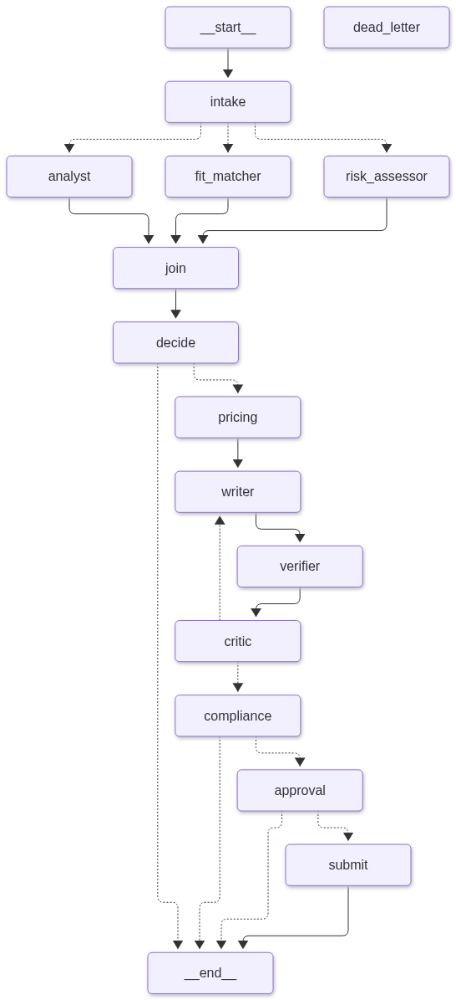
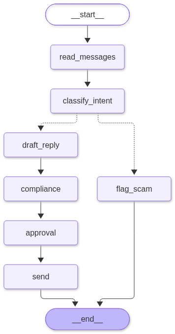

# GigBid: Autonomous Multi-Agent Freelancer Copilot

GigBid is an autonomous multi-agent freelancer copilot that discovers high-affinity contracts, validates client reliability, and drafts proposals grounded in verified portfolio evidence.
Operating on LangGraph StateGraphs with durable PostgreSQL checkpoints, the platform enforces mandatory human-in-the-loop approvals before any proposal or message is dispatched.
GigBid integrates dual MCP interfaces (Marketplace and Portfolio) with deterministic safety guardrails, claim verification, and real-time SSE telemetry.

---

### Project Links
- **Live Deployment**: `<LIVE_URL>`
- **Walkthrough Video**: `<VIDEO_URL>`
- **Engineering Write-Up**: `<WRITEUP_URL>`
- **Repository**: [https://github.com/rauf17/gigbid](https://github.com/rauf17/gigbid)

---

## Architecture Overview

GigBid separates agent coordination into two dedicated, interruptible LangGraph workflows operating over a shared marketplace port and durable persistence layer.

### 1. Bid Evaluation & Proposal Generation Graph (`bid_graph`)


- **Analyst Node**: Extracts atomic client requirements, deliverables, technical stack, and budget bounds into a structured `JobSpec`.
- **Risk Assessor Node**: Executes deterministic safety rules (off-platform contact, unpaid test work, prompt injection) followed by client quality evaluation.
- **Fit Matcher Node**: Maps job requirements against verified portfolio evidence chunks using dense/hybrid retrieval.
- **Decision Node**: Deterministic rule adjudicating bid-or-skip action based on minimum fit, risk ceilings, and Connects expected value.
- **Pricing Node**: Quotes competitive hourly or fixed-price bids within client budget constraints while respecting freelancer floor rates.
- **Writer Node**: Generates evidence-grounded proposals citing verified portfolio case studies (`[E:id]`).
- **Claim Verifier Node**: Splits draft into atomic factual claims, verifies semantic entailment against cited evidence, and excises ungrounded claims.
- **Critic Node**: Evaluates personalization and evidence grounding, triggering revision loops if quality criteria are unmet.
- **Compliance Node**: Deterministically sanitizes text against policy violations (external contact info, banned spam phrases).
- **Approval Checkpoint (`interrupt()`)**: Halts execution, writes durable state to PostgreSQL, and waits for human reviewer approval.
- **Submit Node**: Dispatches approved proposal via the marketplace port.

### 2. Client Conversation & Hold Graph (`conversation_graph`)


- **Read Messages**: Fetches recent client dialogue from marketplace threads.
- **Intent Classifier**: Categorizes incoming messages (question, negotiation, interview request, scam signal).
- **Liaison Draft**: Generates contextual replies incorporating historical style preferences; for interview requests, calls Workspace MCP mock to identify free calendar slots and draft tentative holds.
- **Compliance & Approval**: Enforces communication policies and pauses at human approval checkpoint before outbound delivery.

### 3. Three-Way State Split
- **Graph State (`BidGraphState`, `ConversationGraphState`)**: Ephemeral, in-memory execution state passing handoff schemas between pipeline nodes.
- **Long-Term Memory Store (`AsyncPostgresStore`)**: Cross-thread knowledge persistence tracking promoted user style rules and Laplace-smoothed win rates per category.
- **Application Database (`PostgreSQL`)**: Relational tenant data, user authentication records, run history, and audit traces.

---

## Quick Start & Local Execution

### Prerequisites
- Python 3.11+ and `uv`
- Docker Desktop with Compose
- Groq API Key (for open-weights LLM inference)

### Setup Commands
```bash
# 1. Clone repository and initialize environment
git clone https://github.com/rauf17/gigbid.git
cd gigbid
cp .env.example .env

# 2. Launch PostgreSQL (port 5433) and Redis (port 6380)
make db-up

# 3. Build and launch all local services
docker compose up --build
```

### Reviewer Credentials
- **URL**: `http://localhost:3000` (or `<LIVE_URL>`)
- Reviewer login is in the private Classroom comment.

---

## Telemetry & Trace Samples

When `LANGSMITH_API_KEY` is configured, end-to-end execution traces flow from the UI through FastAPI (`X-Trace-Id`), graph run metadata, and MCP calls to LangSmith with PII anonymization.

- **Trace 1 (Skipped Scam)**: `<TRACE_URL_1>` — Deterministic regex rule `POL-001` blocks off-platform contact lead without LLM cost.
- **Trace 2 (Approved Proposal)**: `<TRACE_URL_2>` — Full proposal generation pipeline pausing at human approval checkpoint and resuming to submission.
- **Trace 3 (Critic Loop & Crash-Resume)**: `<TRACE_URL_3>` — Multi-turn proposal revision loop followed by durable checkpoint recovery after simulated process termination.

---

## Pinned Dependencies (`uv.lock`)

Exact package versions locked for reproducible builds:
- `langgraph`: `1.2.21`
- `langchain-core`: `1.8.0`
- `pydantic`: `2.14.3`
- `fastapi`: `0.162.5`
- `psycopg`: `3.3.9`
- `qdrant-client`: `1.20.0`
- `arq`: `0.28.0`
- `mcp`: `1.30.0`
- `sse-starlette`: `3.7.0`
- `scipy`: `1.17.1`
- `groq`: `0.37.1`

---

## Evaluation Results & Verified Evidence

All benchmark numbers are copied directly from artifacts in `evals/results/` and mapped in [docs/results_index.md](docs/results_index.md):

### R&D Questions Status
- **R&D Question A (Tool Granularity)**: `not run` (evaluated 0 tasks; planned 40-task benchmark across monolithic vs fine-grained tool surfaces).
- **R&D Question B (RAG Retrieval Pipeline)**: Completed across 600 synthetic opportunities (see table below).
- **R&D Question C (Agent Supervision Hierarchy)**: `not run` (evaluated 0 tasks; centralized supervisor vs choreographed StateGraph).

### Overall Retrieval Performance (R&D Question B)
*Source: `evals/results/results_table.md` (Commit: `7d8f600` / `d6e46c2`)*

| Variant | Mode | Recall@5 | R@5 Ceiling | MRR | nDCG@10 | p95 Lat (ms) | Tokens | Queries | Embedder |
|:---|:---:|:---:|:---:|:---:|:---:|:---:|:---:|:---:|:---|
| `random` | `deterministic` | **0.1349** | 0.6806 | **0.3850** | **0.2454** | 0.0 | 0 | 511 | `none` |
| `bm25_text` | `deterministic` | **0.2760** | 0.6806 | **0.6229** | **0.4720** | 20.4 | 0 | 511 | `none` |
| `skill_tag_lookup_REFERENCE`* | `deterministic` | **0.4017** | 0.6806 | **0.5680** | **0.5404** | 2.1 | 0 | 511 | `none` |
| `v0_naive` | `deterministic` | **0.2867** | 0.6806 | **0.7417** | **0.4617** | 88.9 | 0 | 511 | `bge-small-en-v1.5` |
| `v1_decompose` | `real` | **0.2276** | 0.6806 | **0.6660** | **0.4014** | 1671.9 | 363,928 | 511 | `bge-small-en-v1.5` |
| `v2_hybrid` | `deterministic` | **0.3121** | 0.6806 | **0.7363** | **0.4870** | 296.7 | 0 | 511 | `bge-small-en-v1.5` |
| `v3_rerank` | `deterministic` | **0.3308** | 0.6806 | **0.7397** | **0.4878** | 2982.4 | 0 | 511 | `bge-small-en-v1.5` |
| `v4_outcome` | `deterministic` | **0.3298** | 0.6806 | **0.7396** | **0.4880** | 133.2 | 0 | 511 | `bge-small-en-v1.5` |
| `oracle` | `deterministic` | **0.5564** | 0.6806 | **1.0000** | **0.8520** | 0.0 | 0 | 511 | `bm25` |
| `v0_naive_unfiltered` | `deterministic` | **0.0519** | 0.6806 | **0.1904** | **0.0845** | 0.0 | 0 | 511 | `bge-small-en-v1.5` |

*\* Reference baseline only: queries the exact skills field gold labels were derived from (answer key leakage).*

### Multi-Agent Pipeline & Defense Performance
*Source: `evals/results/results_table.md`*

| Benchmark | Mode | Primary Metric | Primary Value | p95 Lat (ms) | Models Used |
|:---|:---:|:---|:---:|:---:|:---|
| Decision Pipeline | `real` | Bid/Skip F1 | **0.7500** | 1698.6 | `openai/gpt-oss-20b`, deterministic heuristics |
| Proposal Verification (R5) | `real` | Post-Verify Unsupported Rate | **0.0000** | 1411.7 | `openai/gpt-oss-120b`, `openai/gpt-oss-20b` |
| Injection Defense (R9) | `real` | Defense Effectiveness Rate | **0.7778** | 2722.5 | `openai/gpt-oss-20b` |

### Proposal Strategy A/B Experiment (Extension X2)
*Source: `evals/results/ab_experiment_latest.json` ($N=120$, paired cohort)*

- **Arm A (Result-First Opener)**: Reply Rate = `0.2333` (28/120), Hire Rate = `0.0417` (5/120).
- **Arm B (Question-First Opener)**: Reply Rate = `0.1083` (13/120), Hire Rate = `0.0000` (0/120).
- **Statistical Significance**: Reply difference is statistically significant (exact McNemar paired $p = 0.0015$; two-proportion $z = 2.5726$, $p = 0.0101$). Hire difference is NOT statistically significant (Fisher's exact $p = 0.0599 \ge 0.05$). Both arms evaluated the exact same 120 candidate jobs against a simulator that rewards metrics by construction.

### Latency, Cost Accounting & Resource Budgets
*Source: `evals/results/budget_latest.json` ($N=20$ benchmark jobs, measured with fallback model)*

| Stage | Declared Target | Measured p95 Latency | Mean Tokens | Mean Cost (USD) | Status |
|:---|:---:|:---:|:---:|:---:|:---:|
| Job Analysed | $\le 12.0\text{s}$ | **`9.749s`** | 1024.7 tokens | **`$0.000000`** | **PASS** (within budget) |
| Proposal Generation | $\le 25.0\text{s}$ | **`8.780s`** | 2256.5 tokens | **`$0.000000`** | **PASS** (within budget) |

> [!NOTE]
> Budget numbers were **measured with fallback model**: in `data/processed/llm_calls.jsonl`, 28 of 87 calls (32.2%) used fallback model `openai/gpt-oss-20b` after the primary Groq rate limit was reached, and 26 of 87 calls were served from cache. Critic-prompt trimming is an **estimated token saving, not measured end to end**.

---

## Repository Map

```text
gigbid/
├── agent/                   # Multi-agent LangGraph workflows, nodes, and policies
│   ├── graphs/              # bid_graph.py and conversation_graph.py
│   ├── nodes/               # analyst, risk, fit, decision, pricing, writer, verifier, critic
│   ├── prompts/             # System prompts and templates (no inline code prompts)
│   ├── accounting.py        # Token usage aggregation and cost tracking
│   ├── memory.py            # Long-term style rule and outcome persistence
│   ├── runtime.py           # Thread execution, checkpoints, and approval interrupts
│   └── tracing.py           # LangSmith telemetry and PII masking hooks
├── apps/                    # User interfaces and entrypoints
│   ├── api/                 # FastAPI backend (auth, runs, SSE stream, reviews, audit)
│   └── web/                 # Next.js 14 App Router web client (live SSE inbox)
├── data/                    # Persona archives, synthetic data generators, and policies
│   ├── personas/            # Verified CVs, case studies, reviews, and repo code
│   └── policy_pack/         # Declarative safety rules in policy.yaml
├── docs/                    # Design documentation, images, and research reports
│   ├── images/              # Rendered architecture graphs and Inspector screenshots
│   ├── REPORT.pdf           # 10-page engineering design review report
│   ├── WRITEUP.md           # Narrative essay on RAG evaluation lessons
│   ├── results_index.md     # Verified metric map linking every claim to JSON files
│   └── RUNBOOK.md           # Local operations, migrations, and deployment guide
├── evals/                   # Evaluation harnesses, datasets, and benchmark results
│   ├── datasets/            # 600-job synthetic evaluation sets across 3 personas
│   ├── results/             # Verified raw JSON benchmark outputs
│   └── runners/             # RAG, decision, proposal, injection, and A/B runners
├── mcp_servers/             # Model Context Protocol service implementations
│   ├── marketplace/         # GigSim marketplace interface (port 8002)
│   ├── portfolio/           # Verified evidence discovery interface (port 8001)
│   └── workspace/           # Mock calendar holds and email drafts (port 8003)
└── tests/                   # Automated regression and contract test suites
```

---

## Honest Limitations

1. **Synthetic Evaluation Dataset**: Benchmarks evaluate against 600 synthetically generated job postings across three archetypes; performance on live, unstructured Upwork job postings will exhibit greater stylistic variance.
2. **Gold Relevance Derived from Skill Tags**: Ground truth relevance was derived from skill co-occurrence in data generation; while realistic, semantic nuances in unstructured text are not fully captured by keyword tag sets.
3. **Simulator Rewards Metric-Led Proposals**: GigSim's simulated client utility function rewards numerical claim density by construction; empirical response from real human clients may diverge.
4. **Sample Sizes**: Multi-agent node evaluations sampled 60 decision opportunities, 15 proposal generations, and 10 adversarial injection probes due to LLM provider daily token allowances.
5. **Upwork Marketplace Adapter is a Stub**: Only the hermetic GigSim simulator port is fully implemented; the live Upwork OAuth scraper adapter remains a documented stub.
6. **GitHub MCP Integration**: Evidence retrieval currently operates over locally indexed repository files rather than live GitHub API connections.
7. **Workspace MCP Mock**: Calendar availability and email drafting tools interact with an in-memory JSON mock store rather than live Google Workspace APIs.
8. **Absence of Human Evaluation Panel**: Proposal grounding and personalization were scored via LLM-as-a-judge (Critic node) rather than an empirical human freelancer review panel.
