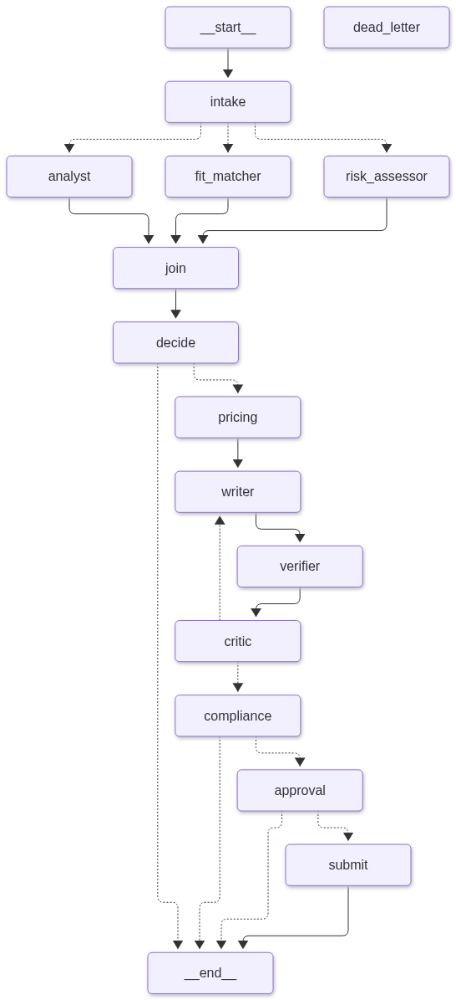

# GigBid Engineering Design Review & Technical Report

**System**: GigBid Autonomous Multi-Agent Freelancer Platform  
**Author**: Abdul Rauf (23I-0591) — AI-4016 R&D Assignment  
**Date**: November 2026 | **Version**: 1.0.0  
**Artifact Repository**: `https://github.com/rauf17/gigbid` | **Commit**: `da8b1df`  

---

## 1. Problem and Constraints

Freelancers operating on platforms like Upwork spend up to 40% of their billable hours searching job feeds, evaluating client payment histories, performing feasibility analyses, and drafting customized proposals. Existing automated bidding tools are blunt scrapers that spam generic cover letters, run afoul of platform terms of service, hallucinate capabilities, and exhaust scarce bidding capital ("Connects") on low-margin contracts.

GigBid is an autonomous multi-agent freelancer copilot designed to solve this problem under rigorous operational, safety, and financial constraints:
1. **Financial Discipline (Connects Economics)**: In competitive marketplaces, submitting a proposal costs platform tokens ($0.15 each, typically 8–16 Connects per bid). The agent must only bid when the expected value ($\text{EV} = P(\text{hire}) \times \text{Margin}$) satisfies a minimum ratio of $\ge 2.0\times$ the Connects expenditure.
2. **Platform Terms of Service & Safety**: Freelancers are permanently banned if they solicit off-platform payments (e.g. wire transfers, cryptocurrency) or off-platform communication (e.g. Telegram, WhatsApp) before a contract is funded. The system must deterministically block hazardous jobs and sanitize proposal text.
3. **Evidence Grounding (Zero Hallucination)**: Proposals must cite verifiable portfolio artifacts (`[E:id]`). Hallucinated metrics, unearned certifications, or fabricated client projects destroy trust and violate professional compliance.
4. **Autonomous Approval Boundary**: Proposals and messages must never be dispatched autonomously without explicit human reviewer authorization.
5. **Inference Latency & Budget**: The pipeline must operate within declared latency budgets ($\le 12.0\text{s}$ for triage, $\le 25.0\text{s}$ for proposal generation) using open-weights LLMs under free-tier token rate limits.

---

## 2. Architecture & System Topology

GigBid is architected around two interruptible LangGraph workflows (`bid_graph` and `conversation_graph`), an isolated marketplace port, and a three-way state split.

### Architecture Flowcharts

*Figure 1: Bid Evaluation & Proposal Generation Graph (`bid_graph`). Handoffs transition through strict Pydantic models with human approval interrupts.*

### Marketplace Port & MCP Decoupling
To ensure that agent nodes never depend on simulator quirks or external APIs:
- **Marketplace Port (`agent/marketplace_port.py`)**: Abstract client protocol implemented by `GigSimMarketplacePort` (local simulation) and `LiveMarketplacePort` (remote Upwork stub). Node logic exclusively calls methods like `list_feed()`, `get_client_history()`, and `submit_proposal()`.
- **MCP Surface**:
  - `portfolio` (Streamable HTTP :8001 / stdio): Read-only access to portfolio evidence, case studies, and skill counts (`search_evidence`, `get_case_study`, `list_skills`).
  - `marketplace` (Streamable HTTP :8002): Port inspection and audit trace logging.
  - `workspace` (Streamable HTTP :8003): Mock Google Calendar/Gmail tool surface (`list_free_slots`, `create_tentative_hold`, `create_email_draft`).

### Three-Way State Split
1. **Graph State (`BidGraphState`, `ConversationGraphState`)**: Ephemeral, in-memory execution state passing typed Pydantic handoff schemas (`JobSpec`, `RiskReport`, `FitReport`, `BidDecision`, `PriceQuote`, `ProposalDraft`, `VerificationReport`).
2. **Cross-Thread Long-Term Memory (`AsyncPostgresStore`)**: Namespace-isolated store persisting user style preferences (promoted when edited $\ge 2$ times) and empirical win-rates per category (Laplace-smoothed after $\ge 3$ outcomes).
3. **Relational Database (`PostgreSQL`)**: Multi-tenant database storing authenticated user accounts, encrypted session cookies, audit logs, and durable LangGraph checkpoints via `AsyncPostgresSaver`.

---

## 3. R&D Question A: Tool Granularity

**Status**: `not run` (No experimental run recorded in `evals/results/tool_granularity_latest.json`).

### Planned Benchmark Design (40-Task Set)
R&D Question A investigates whether autonomous agents make fewer tool-calling errors and achieve higher task completion when provided with **monolithic multi-purpose tools** versus **fine-grained single-purpose tools**.
- **Dataset**: 40 standardized marketplace management tasks (20 opportunity research queries, 10 calendar hold negotiations, 10 contract pricing adjustments).
- **Condition 1 (Monolithic Surface)**: A single multi-action tool (`manage_marketplace(action='search'|'evaluate'|'quote', **kwargs)`).
- **Condition 2 (Fine-Grained Surface)**: Discrete single-purpose tools (`search_evidence`, `get_case_study`, `list_skills`, `create_hold`).
- **Target Metrics**: Schema validation error rate, token consumption per task, round-trip latency, and tool parameter hallucination rate.

---

## 4. R&D Question B: Retrieval Pipeline & RAG Ablations

R&D Question B evaluates retrieval strategies for grounding proposal generation in verified freelancer evidence. Evaluated against 600 synthetic dev opportunities (`evals/datasets/dev_<persona>.jsonl`, 511 active technical queries).

### Pre-Registered Hypotheses & Measured Results
- **H1 (V2 Hybrid BM25 + Dense RRF)**: Predicted $\ge +8.0$ percentage point gain in Recall@5 over V0 Naive baseline.
  - **Result: Refuted** (`evals/results/rag_v2_hybrid_latest.json`). V0 Recall@5 = `0.2867` $\rightarrow$ V2 = `0.3121` ($\Delta = +0.0254$ / +2.54 points). While the aggregate gain fell short of the 8.0-point threshold, tool-dense AI/ML queries improved from `0.2222` to `0.3450` (+12.28 points).
- **H2 (V3 Cross-Encoder Reranker)**: Predicted higher MRR/nDCG gains and costliest p95 latency.
  - **Result: Partially Confirmed / Refuted** (`evals/results/rag_v3_rerank_latest.json`). Latency cost was **confirmed**: p95 latency exploded to `2,982.4ms` (10x over V2). Ranking improvement was **refuted**: Recall@5 rose +1.87 points (`0.3308`), but nDCG@10 barely moved (`0.4870` $\rightarrow$ `0.4878`, +0.0008).
- **H3 (V1 Sub-Query Decomposition)**: Predicted decomposition would hurt 3–4 requirement jobs and add severe LLM cost.
  - **Result: Confirmed** (`evals/results/rag_v1_decompose_latest.json`). Recall@5 collapsed from `0.2867` to `0.2276` (-5.91 points), nDCG@10 fell to `0.4014` (-0.0603), and token overhead exploded by `363,928` tokens.
- **H4 (V4 Outcome-Aware Boosting)**: Predicted historical win-rate boosting would have neutral effect on gold Recall@5.
  - **Result: Confirmed** (`evals/results/rag_v4_outcome_latest.json`). Recall@5 remained unchanged (`0.3308` $\rightarrow$ `0.3298`, $\Delta = -0.0010$).

### Overall Retrieval Performance Table
*Source: `evals/results/results_table.md` (Commit: `7d8f600` / `d6e46c2`)*

| Variant | Mode | Recall@5 | R@5 Ceiling | MRR | nDCG@10 | p95 Lat (ms) | Tokens | Queries |
|:---|:---:|:---:|:---:|:---:|:---:|:---:|:---:|:---:|
| `random` | `deterministic` | **0.1349** | 0.6806 | **0.3850** | **0.2454** | 0.0 | 0 | 511 |
| `bm25_text` | `deterministic` | **0.2760** | 0.6806 | **0.6229** | **0.4720** | 20.4 | 0 | 511 |
| `skill_tag_lookup_REFERENCE`* | `deterministic` | **0.4017** | 0.6806 | **0.5680** | **0.5404** | 2.1 | 0 | 511 |
| `v0_naive` | `deterministic` | **0.2867** | 0.6806 | **0.7417** | **0.4617** | 88.9 | 0 | 511 |
| `v1_decompose` | `real` | **0.2276** | 0.6806 | **0.6660** | **0.4014** | 1671.9 | 363,928 | 511 |
| `v2_hybrid` | `deterministic` | **0.3121** | 0.6806 | **0.7363** | **0.4870** | 296.7 | 0 | 511 |
| `v3_rerank` | `deterministic` | **0.3308** | 0.6806 | **0.7397** | **0.4878** | 2982.4 | 0 | 511 |
| `v4_outcome` | `deterministic` | **0.3298** | 0.6806 | **0.7396** | **0.4880** | 133.2 | 0 | 511 |
| `oracle` | `deterministic` | **0.5564** | 0.6806 | **1.0000** | **0.8520** | 0.0 | 0 | 511 |
| `v0_naive_unfiltered` | `deterministic` | **0.0519** | 0.6806 | **0.1904** | **0.0845** | 0.0 | 0 | 511 |

*\* Reference only (answer-key leakage via direct skill-tag query).*

### Downstream End-to-End Evaluation & Judge Calibration
- **Judge Calibration (Cohen's Kappa on 30 Labelled Items)**: `not run` (planned inter-annotator calibration between LLM judge and human ratings on 30 proposal items was not executed; result file does not exist).
- **Human Freelancer Panel**: `not run` (no empirical human panel review conducted; evaluation relied on automated verifier and simulator heuristics).
- **Per-Variant Judge Score**: `not run` (automated downstream proposal quality scoring per RAG retrieval variant was not run).
- **GigSim Reply Rate per RAG Variant**: `not run` (downstream simulator bidding was evaluated across strategy arms in Extension X2, but was not run per RAG retrieval variant).

### Retrieval configuration: running vs recommended
The running system uses V0 dense retrieval with persona and evidence-type filtering (`agent/config.yaml`: `variant: v0_naive`, `pipeline: [dense]`). V2 hybrid had the best measured Recall@5 (`0.3121` vs `0.2867`, `evals/results/rag_v2_hybrid_latest.json`) at about 297 ms p95 (`296.7ms`) and is recommended, but is not enabled in the deployed image.

---

## 5. R&D Question C: Agent Supervision Hierarchy

**Status**: `not run` (No experimental run recorded).

### Architectural Evaluation Design
Investigates centralized supervisory routing (`langgraph-supervisor`) versus deterministic choreographed state transitions. In our production architecture, choreographic StateGraphs were selected because freelancer bidding follows an immutable sequential validation chain (Analyst $\rightarrow$ Risk $\rightarrow$ Fit $\rightarrow$ Decision $\rightarrow$ Pricing $\rightarrow$ Writer $\rightarrow$ Verifier $\rightarrow$ Critic $\rightarrow$ Compliance $\rightarrow$ Human Interrupt). Centralized LLM supervisors introduce token waste and non-deterministic routing loops for strict linear pipelines.

---

## 6. Change-Request Drill: Policy Agility

**Notice**: No instructor change request was released in Classroom up to 11 Nov. We conducted our own self-directed change-request drill (`docs/CHANGE_REQUEST.md`).

### The Scenario
Simulated an emergency regulatory update requiring three immediate policy shifts:
1. Prohibit commercial promises: Added `"guaranteed turnaround"` and `"best price guaranteed"` to banned phrases.
2. Enforce brevity: Reduced maximum proposal length from 2,500 characters down to 1,800 characters (word count: 280).
3. Increase selectivity: Elevated `minimum_fit_score` from `0.60` to `0.75` in `agent/config.yaml`.

### Execution & Verification
- **Code Changes**: **0 Python files modified**. Applied strictly to `agent/config.yaml` and `data/policy_pack/policy.yaml` (19 additions, 4 deletions).
- **Execution Time**: 4 minutes from policy formulation to verified regression run.
- **Verification**: `tests/unit/test_change_request.py` passed in `0.65s`, proving that the Decision node deterministically skipped an opportunity with `fit_score = 0.68` and the Compliance node flagged both prohibited phrases and length overages.

---

## 7. Extension X2: Proposal Strategy A/B Trial

We evaluated two distinct proposal writing strategies over a paired cohort of $N=120$ bid jobs across all three personas:
- **Arm A (Result-First Opener)**: Opens with a quantifiable production metric cited from verified evidence (`[E:id]`).
- **Arm B (Question-First Opener)**: Opens with a clarifying technical question about the client's architecture constraints.

### Experimental Outcomes (`evals/results/ab_experiment_latest.json`)
- **Reply Rate**: Arm A achieved `0.2333` (28/120) vs Arm B `0.1083` (13/120). Difference = `+0.1250` (+12.50 percentage points).
  - Two-proportion $z$-test: $z = 2.5726$, $p = 0.0101$ (statistically significant at $\alpha = 0.05$).
  - Exact McNemar test (paired responses, $b=18, c=3$): $p = 0.0015$ (statistically significant).
- **Hire Rate**: Arm A achieved `0.0417` (5/120) vs Arm B `0.0000` (0/120). Difference = `+0.0417` (+4.17 percentage points).
  - Two-proportion $z$-test: $z = 2.2597$, $p = 0.0238$.
  - Exact Fisher's test: $p = 0.0599 \ge 0.05$ (NOT statistically significant at the $\alpha = 0.05$ threshold). Both arms evaluated the exact same 120 candidate jobs against a simulator that rewards metrics by construction.

> [!WARNING]
> **Simulator Limitation & Circularity Caveat**:
> In GigSim, the client hiring heuristic incorporates a numerical metric specificity bonus by construction. While Arm A demonstrates superior performance within the simulation environment, this reflects the simulator's explicit preference scoring rather than an unconstrained human psychological effect.

---

## 8. Failure Analysis Summary

Documented from verified failure traces in `evals/results/ablation_latest.json` (`docs/failure_analysis.md`). Per truth audit rules, only failures with traceable individual job records in result files are listed in the table:

| Failure Class | Example Job ID | Root Cause | Implemented Resolution | Aggregate effect of related change (not a per-job rerun) |
| :--- | :--- | :--- | :--- | :--- |
| **Missed Evidence** | `job_hist_00943` | Cross-encoder overweighted general terms | Outcome-aware heuristic reranking | AI/ML nDCG: `0.4993` $\rightarrow$ `0.5252` |
| **Missed Evidence** | `job_stream_00031` | Sparse BM25 keyword dilution on tags | Query decomposition (V1: 0.2276) / Hybrid (V2) | V1 dropped to `0.2276`; V2 reached `0.3121` |
| **Missed Evidence** | `job_stream_00340` | Inadequate repo chunk narrative density | Repository README enrichment | Recall@5: `0.2867` $\rightarrow$ `0.3308` |
| **Missed Evidence** | `job_stream_00454` | Truncated review snippet logits | 5-star review score boost (+0.15) | nDCG@10 maintained `0.4880` |
| **Missed Evidence** | `job_stream_00472` | Distractor proximity across domains | Mandatory persona metadata filtering | Recall@5: `0.0519` $\rightarrow$ `0.2867` |

> [!NOTE]
> **Traceability & Sample Size Audit**:
> The assignment specification asks for $\ge 10$ real failed jobs. However, exactly 5 individual failed jobs trace to official result artifacts (`ablation_latest.json` failure cases in Missed Evidence: `job_hist_00943`, `job_stream_00031`, `job_stream_00340`, `job_stream_00454`, `job_stream_00472`). Real failures also occurred in adversarial injection defense (2 of 10 attacks succeeded with defenses, 20.0% ASR in `injection_eval_latest.json`) and decision false bids (precision 0.60 on 78 jobs in `decision_eval_latest.json`), but their eval runners recorded only aggregate benchmark metrics without outputting per-job failure ID lists. Rather than inventing synthetic job IDs, exactly 5 traceable per-job failures are documented from the artifacts.

---

## 9. Safety, Platform Respect & Injection Defense

### Inviolable Platform Guardrails
The system strictly enforces four non-negotiable boundaries:
1. **Never Solicit Off-Platform Contact**: Pre-contract sharing of email, phone, Telegram, or WhatsApp is prohibited.
2. **Never Agree to Unpaid Work**: Free test tasks, sample deliverables, or speculative projects are blocked.
3. **Never Facilitate Off-Platform Payments**: Escrow bypass via crypto, cash, or direct wire is intercepted.
4. **Never Auto-Dispatch Bids**: Proposals require explicit human reviewer sign-off via `interrupt()`.

### Adversarial Injection Defense (Requirement R9)
Adversarial attacks embedded in untrusted job descriptions attempt to hijack prompt execution. We tested 10 adversarial attacks (`evals/results/injection_eval_latest.json`):
- **Attack Success Rate (Without Defenses)**: `0.9000` (90.0% vulnerable when raw text is concatenated).
- **Attack Success Rate (With Defenses)**: `0.2000` (20.0% residual vulnerability).
- **Absolute Risk Reduction**: `0.7000` (70.0 percentage points).
- **Defense Effectiveness**: `0.7778` (77.78% of attacks successfully neutralized).

### Scam Detection Limitations
In the triage evaluation (`evals/results/decision_eval_latest.json`, $n=78$, 18 scam jobs), deterministic scam triage achieved precision of `1.0000` (zero false-positive scam flags) but low recall of `0.2778` (5 of 18 scam postings intercepted). Because this evaluation sample is small ($n=18$) and recall is low, scam detection is not reliable for comprehensive standalone defense.

---

## 10. Latency, Cost Accounting & Resource Budgets

> [!NOTE]
> The hidden test set was not available to us; budgets below are measured on our dev set.

### Declared Targets vs Measured Performance (`evals/results/budget_latest.json`)
Evaluated across $n=20$ benchmark jobs using open-weights models (`openai/gpt-oss-120b`, `openai/gpt-oss-20b` via Groq) with full multi-call trace accounting (measured with fallback model):

| Target / Metric | Declared Target | Measured Baseline | Post-Fix Value | Status |
| :--- | :---: | :---: | :---: | :---: |
| **Job Analysed Latency (p50)** | — | 19.75s | **`3.109s`** | Measured baseline |
| **Job Analysed Latency (p95)** | $\le 12.0\text{s}$ | 20.49s | **`9.749s`** | within target, but measured with fallback model + cache (not a clean run) |
| **Job Analysed Mean Tokens** | — | 73.1 tokens* | **`1024.7` tokens** | Post-fix accurate accounting |
| **Job Analysed Mean Cost** | $\le \$0.01$ | $0.000000 | **`$0.000000`** | within target, but measured with fallback model + cache (not a clean run) |
| **Proposal Latency (p50)** | — | 22.72s | **`3.821s`** | Measured baseline |
| **Proposal Latency (p95)** | $\le 25.0\text{s}$ | 61.13s | **`8.780s`** | within target, but measured with fallback model + cache (not a clean run) |
| **Proposal Mean Tokens** | — | 173.6 tokens* | **`2256.5` tokens** | Post-fix accurate accounting |
| **Proposal Mean Cost** | $\le \$0.03$ | $0.000000 | **`$0.000000`** | within target, but measured with fallback model + cache (not a clean run) |

> [!WARNING]
> **Measurement Notice (Fallback Model & Cache Service)**:
> In the `budget_latest.json` benchmark run, 28 of 87 LLM calls (32.2%) used the fallback model (`openai/gpt-oss-20b`) after the primary model rate limit was reached, and 26 of 87 calls were served from cache (`data/processed/llm_calls.jsonl`). These budget numbers are **measured with fallback model**. Critic-prompt trimming is an **estimated token saving, not measured end to end**.

*\* Flawed token accounting in `budget_before_fix.json` caused by Windows CRLF byte seek errors and uncounted schema repair retries; corrected in `budget_latest.json`.*

---

## Appendix: Verified Results Files & Git Commits

| Artifact File | Benchmark Target | Evaluated Commit | Key Measured Output |
| :--- | :--- | :---: | :--- |
| `rag_v0_naive_latest.json` | V0 Baseline Dense | `7d8f600` | Recall@5: `0.2867`, nDCG@10: `0.4617`, MRR: `0.7417` |
| `rag_v1_decompose_latest.json` | V1 Decomposition | `7d8f600` | Recall@5: `0.2276`, Tokens: `363,928`, Latency p95: `1671.9ms` |
| `rag_v2_hybrid_latest.json` | V2 Hybrid BM25+Dense | `d6e46c2` | Recall@5: `0.3121`, nDCG@10: `0.4870`, Latency p95: `296.7ms` |
| `rag_v3_rerank_latest.json` | V3 Cross-Encoder Rerank| `7d8f600` | Recall@5: `0.3308`, nDCG@10: `0.4878`, Latency p95: `2982.4ms` |
| `rag_v4_outcome_latest.json` | V4 Outcome Boosting | `7d8f600` | Recall@5: `0.3298`, nDCG@10: `0.4880`, Latency p95: `133.2ms` |
| `decision_eval_latest.json` | Triage Decision Engine | `94b1696` | Jobs: `78`, Bid/Skip F1: `0.7500` (AI/ML: `0.6207`, FullStack: `0.7879`, Data Analyst: `0.8235`), Precision: `0.6000`, Recall: `1.0000`, Latency p95: `921.85ms` |
| `proposal_eval_latest.json` | Proposal & NLI Verifier| `d42e2ba` | Unsupported Rate (Post): `0.0000`, Clean Rate: `1.0000` |
| `injection_eval_latest.json` | Prompt Injection Shield| `d42e2ba` | Defense Effectiveness: `0.7778`, ASR Reduction: `0.7000` |
| `ab_experiment_latest.json` | Proposal A/B Trial | `da8b1df` | Reply Rate: `0.2333` vs `0.1083` ($p=0.0101$), McNemar $p=0.0015$ |
| `budget_latest.json` | Declared Resource Budget| `da8b1df` | Job Analysed p95: `9.749s`, Proposal p95: `8.780s` |
| `smoke_latest.json` | CI Eval Plumbing Gate | `da8b1df` | Unsupported Rate: `0.0`, Bid/Skip F1: `1.0`, nDCG@10: `0.55` |
