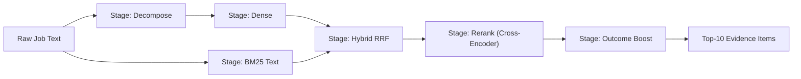

# GigBid RAG Retrieval Architecture

This package implements the composable multi-stage retrieval architecture for the GigBid autonomous freelancer platform (AI-4016 Requirements B2, B4, B5).

## Architecture Overview

Retrieval is structured as modular, composable stages that can be sequenced in `agent/config.yaml`:

## Retrieval Stages

| Stage | Class | Description |
|:---|:---|:---|
| `dense` | `DenseStage` | Qdrant dense vector similarity using `BAAI/bge-small-en-v1.5` over the experience pool. |
| `decompose` | `DecomposeStage` | Calls LLM node `requirement_decomposer` to extract 2–8 atomic technical requirements. |
| `merge` | `MergeStage` | Executes dense retrieval per requirement and fuses candidate lists via Reciprocal Rank Fusion ($k=60$). |
| `hybrid` | `HybridStage` | Fuses dense semantic similarity and BM25 text retrieval over full job text via RRF ($k=60$). |
| `rerank` | `RerankStage` | Pairwise Cross-Encoder (`cross-encoder/ms-marco-MiniLM-L-6-v2`) reranking top-30 candidates down to top-10. |
| `outcome_boost` | `OutcomeBoostStage` | Modulates candidate scores by empirical win rate in past proposals: $\text{score} \times (1 + \alpha \cdot \text{win\_rate})$. |

## Named Presets

| Variant ID | Pipeline Configuration | Focus |
|:---|:---|:---|
| `v0_naive` | `[dense]` | Baseline dense cosine similarity. |
| `v1_decompose` | `[decompose, dense, merge]` | Requirement decomposition for multi-skill jobs. |
| `v2_hybrid` | `[hybrid]` | Dense + BM25 text fusion via RRF. |
| `v3_rerank` | `[hybrid, rerank]` | Hybrid search + cross-encoder reranking. |
| `v4_outcome` | `[hybrid, rerank, outcome_boost]` | Hybrid + rerank + proposal win rate boost. |

## Item-Level Rollup & Experience Type Filter

Every stage strictly adheres to:
1. **Experience Pool Filtering**: Restricts retrieval to `case_study`, `repo_readme`, `repo_code`, `review`, and `cv`, preventing proposal text from polluting evidence rankings.
2. **Item-Level Rollup**: Deduplicates fine-grained chunks up to project/item IDs (`roll_up_to_item_id`) so evidence chunks do not crowd out diverse portfolio proof points.
